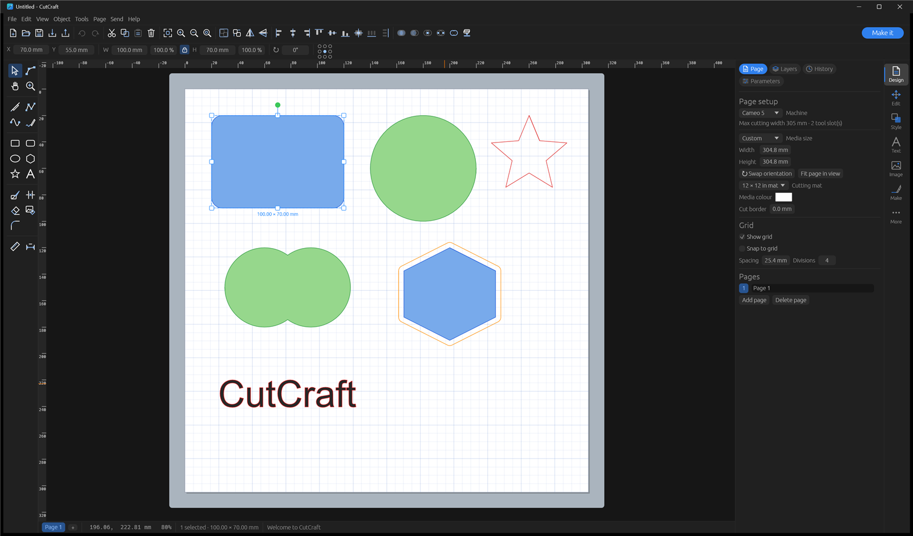

<div align="center">

# ✂️ CutCraft

**A fast, offline, no-subscription design-and-cut studio for desktop vinyl & paper cutters - written in Rust.**

Design, trace, lay out and send jobs to Silhouette (Cameo / Portrait / Curio), Graphtec, Brother ScanNCut and ~120 other cutters, all from a single native binary. No account, no cloud, no monthly fee.

Runs on **Windows**, **Linux** and **macOS 14+**.



</div>

---

## Table of contents

- [Why CutCraft](#why-cutcraft)
- [Highlights](#highlights)
- [Install & run](#install--run)
- [Features](#features)
  - [Canvas & editing](#canvas--editing)
  - [Text & fonts](#text--fonts)
  - [Image tracing](#image-tracing)
  - [Effects & distortion](#effects--distortion)
  - [Path tools](#path-tools)
  - [Art library](#art-library)
  - [From the web](#from-the-web)
  - [Packaging & production](#packaging--production)
  - [Print & Cut](#print--cut)
  - [Sending to a cutter](#sending-to-a-cutter)
- [Machine & protocol support](#machine--protocol-support)
- [File formats](#file-formats)
- [Project layout](#project-layout)
- [Building & testing](#building--testing)
- [Limitations & caveats](#limitations--caveats)
- [License](#license)

A full user guide is in the [wiki](../../wiki).

---

## Why CutCraft

Most cutting software is either locked behind a subscription and a cloud account, or is a dated desktop tool that does the pro features badly. CutCraft takes the opposite stance:

- **Offline & private** - your designs never leave your machine.
- **One fast native binary** - Rust + [egui]; no Electron, no installer required.
- **Open formats** - native files are gzipped JSON; import/export SVG, DXF, PDF, G-code and plotter languages.
- **Pro features the consumer tools gate or lack** - smooth curve tracing, single-stroke (centre-line) tracing, true-shape nesting, non-destructive effect stacks, packaging dielines, Print & Cut calibration and job costing.
- **Broad hardware support** - one app speaks to Silhouette, Graphtec, Brother ScanNCut and a large roster of vinyl and craft cutters.

## Highlights

**Home:** starting CutCraft without a file shows your recent designs with previews (File ▸ Home); open one, start a new design, or browse a folder of designs.

**The workspace:** an icon toolbar (file, undo, clipboard, zoom, group, flip, align, weld) with a **Make it** button to send the job; a two-column tool strip on the left; and on the right a category rail - **Design, Edit, Style, Text, Image, Make, More** - each opening its panels as tabs. All icons are drawn as vectors, so they stay sharp at any size, in the dark or light theme (More ▸ Prefs).

| | |
|---|---|
| 🖊️ **Smooth & centre-line tracing** | Traced outlines are found at sub-pixel precision and fitted with clean curves, sharp corners kept - or turned into *single strokes* for sketch pens, foil quill and engraving. |
| 🖼️ **Subject trace** | Point it at a photo of a real object; the background is isolated and removed to give a clean cut line. |
| 🧩 **True-shape nesting** | Outlines genuinely interlock (with rotation) to pack more onto every sheet and save material. |
| 🪄 **Live effect stack** | Non-destructive, re-orderable Offset / Round / Warp / Simplify / Smooth per shape - tweak forever, bake when ready. |
| 🗂️ **Make it screen** | The design split onto mats by material, line colour, fill colour or layer; pack all mats or just one; see your real mat with **PixMat**. |
| 🎯 **Print & Cut calibration** | Print and cut a test sheet, photograph it, and CutCraft measures and corrects the offset for every Print & Cut job. |
| 🌐 **Icons & fonts from the web** | Search open icon sets and open-licensed fonts inside CutCraft, or browse SVG Repo and FONT Repo in the built-in browser - downloads come straight in. |
| 🔌 **Multi-protocol output** | Switchable GPGL / HP-GL / DMPL, Brother ScanNCut over USB; USB, network, Bluetooth or file. |

## Install & run

CutCraft is a Cargo workspace. With a recent Rust toolchain installed:

```bash
# clone, then:
cargo run --release -p cutcraft
```

Handy invocations:

```bash
cargo run -p cutcraft -- --sample              # open a sample design
cargo run -p cutcraft -- path/to/file.cutcraft # open a file (.svg / .dxf / image also work)
cargo test -p cutcraft-core                     # run the core test suite
```

Requires **Rust 1.85+ (2024 edition)**. It builds and runs on **Windows**, **Linux** and **macOS 14 (Sonoma) or later**. The optimized binary is `target/release/cutcraft.exe` (Windows) / `cutcraft` (Linux/macOS). Drag-and-drop of SVG/DXF/image files onto the window works.

**The built-in browser on Linux** uses WebKitGTK, so building needs its development packages. On Debian/Ubuntu:

```bash
sudo apt install libwebkit2gtk-4.1-dev libgtk-3-dev
```

(Fedora: `webkit2gtk4.1-devel gtk3-devel`; Arch: `webkit2gtk-4.1 gtk3`.) To build without the browser instead, add `--no-default-features`. WebKitGTK can only sit inside an X11 window, so on a Wayland desktop CutCraft opens through XWayland; set `CUTCRAFT_WAYLAND=1` to keep native Wayland, without the browser. On Windows (Edge WebView2, part of Windows 10/11) and macOS (the system WebKit) the browser is always built in.

**Graphics:** CutCraft draws with the graphics chip. At start-up it tries DirectX 12 on Windows (Vulkan on Linux, Metal on macOS) on a real graphics chip, then OpenGL - older chips without DirectX 12 usually still have an OpenGL driver - and only if both fail, Windows' slow software renderer, so it still opens on a PC with no working graphics driver. If the GPU renderer ever crashes at start-up, the next start switches to OpenGL by itself (delete `use-opengl` in the settings folder to try the GPU again); set `CUTCRAFT_RENDERER=gl` to force OpenGL. Each start writes `startup.log` to the settings folder (`%APPDATA%\CutCraft` on Windows); its `graphics:` line names the chip and renderer in use - "Basic Render Driver" or `Cpu` means software drawing, which installing the chip maker's driver (Intel/AMD/NVIDIA, not Windows Update) fixes. The window only redraws when something changes, so it sits at near-zero CPU while idle.

## Features

### Canvas & editing

- Page on a cutting mat, snapping grid, rulers, multiple pages and layers, cut-lines-only view.
- **Edit bar** above the canvas - type the selection's X/Y, width/height (mm or %), lock the aspect ratio, enter a rotation, and pick which of 9 anchor points they refer to; with text selected it also shows font, size, bold/italic and weld. Dragging or typing in a field is one undo step.
- **Measure** (M) - drag between two points for the distance, ΔX/ΔY and angle; nothing is added. **Dimension** - drag to add a labelled dimension line (a drawing aid: not cut, not printed). **Trim** - click a piece of a path to delete it back to the nearest lines crossing it. All three snap to objects and guides.
- **Symmetry drawing** (View → Symmetry) - shapes you draw are repeated as you draw them: mirror left-right, top-bottom, four-way, or radial mandala (2-64 copies, optionally mirroring alternate slices like a kaleidoscope), about the page centre or the selection's centre. Ghost copies and the axes show while drawing; the set is grouped.
- **Layer colours** - new shapes take the current layer's colour; moving shapes to another layer, or changing a layer's colour, recolours the shapes that were using the old layer colour (custom colours are kept). **Apply layer colours** (Layers panel) gives every outlined shape its layer's colour. Outline colour is what "By line colour" cutting uses.
- **Window / crossing selection** - drag a box left to right to select only shapes wholly inside it (solid blue box); drag right to left to select anything whose lines the box touches, and pictures it overlaps (dashed green box). Shift adds to the selection.
- **Ruler guides** - drag from the top or left ruler to place a guide; drag a guide to move it, or back onto a ruler to remove it (View → Clear guides removes them all). Guides are saved with the design but never cut; drawing, point edits and Smart Guides snap to them.
- **Smart Guides** - while moving, the selection's edges and centre snap into line with other shapes and the page, with guide lines shown. **Snap to objects** - drawing and point edits snap to other shapes' corners, centres and nodes. Both toggle in the View menu.
- Zoom (wheel / Ctrl±) and pan (middle-drag / Shift+wheel / Pan tool).
- **Right-click context menu** with actions suited to what you selected (trace an image, edit text, combine multiple shapes, arrange/transform, convert to path …).
- Tools: select (move/scale/rotate handles, Shift to constrain), rubber-band select, node editing (drag nodes & handles, add/delete points, line ⇄ curve), line, polyline, smooth curve, freehand, rectangle, rounded rectangle, ellipse, polygon, star, text, knife, eraser, zoom. Their settings (corner radius, polygon sides, star points, eraser size) are in **Edit ▸ Drawing tools**.
- **Round-corner tool** - click any corner of a path to round or chamfer just that corner; rounded corners can be resized again, and radius 0 makes one sharp.
- **Image tool** - four modes in the edit bar: **Erase** (brush parts away), **Restore** (brush them back from the original), **Select & erase** (click an area of one colour - e.g. a white background - to clear it, with a tolerance and an *everywhere* option), and **Crop** (drag a box to keep just that part).
- **Parametric design** (Parameters tab) - named values (`thickness = 3`, `slot = thickness + 0.2`) and locked sizes and distances whose values are numbers or formulas (mm, or `2in` / `5cm`). Select one shape to lock its width or height (pick which edge stays still), or two to lock the distance between them (the smaller one moves). Change a parameter and everything that uses it updates; constraints are kept as you edit, shown on the canvas as blue dimensions (View → Show constraints), and saved with the design. A size lock scales the shape, so rounded corners stretch with it.
- **History panel** - every undo step listed by name (Move, Resize, Weld, Fill & Line…); click one to jump back to it, or forward again to a greyed step you undid.
- Editing: 200-step undo/redo, cut/copy/paste/paste-in-place/duplicate, group/ungroup, arrange, flip, rotate, scale, shear, align & distribute, weld, subtract, **subtract all** (every shape on top cuts through whatever it overlaps underneath - many holes in one shape, or one shape through several), intersect, **exclude** (remove only the overlaps; each shape keeps its colour), **unite** (cut as one welded outline but keep the parts - ungroup to separate), divide (slice), compound make/release, convert to path, offset (inner/outer, round/sharp), simplify/smooth.
- Replicate: rows, columns, rotate, mirror, fill page, advanced (count + offset + per-step rotation).
- **Fit into box** - scale a design (or text) to fit inside the largest selected shape, centred.
- Style: fill & line colours (with a **Transparent** swatch, a working opacity slider, and a **screen eyedropper** that picks a colour from anywhere on screen - Windows), line thickness, cut style (no-cut / cut / cut-edge / perforate), don't-print flag.
- **Contour** (Style ▸ Fill & Line) - tick which of a shape's outlines are cut, to hide inner lines without breaking the shape up; hovering a line highlights it. It's a live effect, so it can be changed back any time.
- **Flatten / Unflatten** - turn a selection into one printed picture with a single outer cut line for Print Then Cut; Unflatten brings the original shapes back.
- **Pattern fill** (Style ▸ Fill & Line) - fill a shape with a repeating picture (tile size and angle) to print; its outline is still cut.
- **Colour sync** (Style ▸ Colours) - every line colour in the design with its shape count; click a swatch to select those shapes, or merge one colour into another so they cut together on one material.

### Text & fonts

- Any installed font; size, bold/italic, alignment, character & line spacing, vertical text, text-on-a-path, convert to path.
- **Curve text** - bend text round a circle with one slider (Text panel or the edit bar): positive arches it up like a badge, negative curves it into a smile; it stays editable text.
- **Kerning** - adjust the space between any two letters (Text panel: pick the pair, drag the slider).
- **Glyphs** - every character a font contains (swashes, symbols, accents) in a clickable grid in the Text panel.
- **Ungroup to letters / lines** - split a text into one editable text per letter (or per line), each exactly where it was, to nudge or rotate letters individually.
- **Weld letters** - fuse overlapping letters of script fonts into one outline so the blade doesn't cut through every join.
- **CutCraft Single Line** - a built-in stroke font (full printable ASCII): each letter is one pen stroke, for fast sketch-pen, foil or engrave text.
- **Web fonts** (Text ▸ Web fonts) - 2,000+ open-licensed fonts from [Fontsource] to add with one click, or **Add font file…** for any `.ttf` / `.otf`. Added fonts live in CutCraft's own fonts folder - no system install needed.
- **Font creation** - assign drawn or traced shapes to keys (one at a time or a whole alphabet left-to-right), use the font immediately, and export a real TrueType `.ttf`.
- **Mail merge** - `{{Field}}` placeholders, CSV import (quoted fields; `,`, `;` or tab), one copy per row laid out in a grid across extra pages. Built-in fields `{{serial}}`, `{{serial:0000}}`, `{{row}}`, `{{date}}`, `{{time}}`, plus **numbered copies** without any CSV (e.g. tags reading "No. 001…100").
- **Monogram** - classic three-letter monogram (large surname initial centred) with none / circle / ring / diamond frame; letters stay editable.
- **Spell-check** - Hunspell dictionaries (auto-detects LibreOffice/OpenOffice or `%APPDATA%\CutCraft\dictionaries`), suggestions, add-to-dictionary.

### Image tracing

- **Upload wizard** - importing a picture asks how it'll be used: **Print Then Cut image** (printed, with a cut line round it), **Cut image** (just its outer shape) or **Flat graphic** (printed, not cut), with one-click **background removal** and a preview of the cut line.
- **Smooth, sharp cut lines** - outlines are found between the pixels at sub-pixel precision (using the picture's own anti-aliased edges), small wobbles are evened out, and the result is fitted with as few Bézier curves as the **Smoothness** setting allows, with real corners kept sharp - no pixel stair-steps.
- **Brightness** and **colour** trace with blur, despeckle, outer-edge-only and curve fitting, with live preview.
- **Subject** trace - isolates an object from a plain background (flood-fill from the borders) for photos of real items.
- **Auto threshold** - one-click Otsu split.
- **Centre-line** mode - skeletonises the shape to single-stroke open paths for pens, foil and engraving.
- **Image tools** - non-destructive **adjustments** (brightness, contrast, gamma, sharpen, auto-levels, invert, remove background, and Sketch / Line-art / Edges effects) with a live preview, feeding:
  - **Photo → lines** - redraw a photo as a single continuous **spiral**, rows of **waves**, or **stipple** dots: line art for sketch pens.
  - **Shadow box** - split a picture into 2-8 stacked papercut plates by brightness (front plate most open, back plate solid) for backlit layered art.
  - Optional *bake into image* to apply the adjustments permanently (e.g. before tracing).
- **PixScan** - print a four-marker sheet, photograph your item on it, markers are detected (or drag the corners onto known points), perspective is removed and the photo is placed at true size.

### Effects & distortion

- **Live, non-destructive effect stack** per shape: add/reorder/remove Offset, Round-corners, any envelope Warp, Simplify and Smooth; tweak live, then *Release to paths* to bake.
- One-shot distortions: arch, bulge, bridge, wave, flag, perspective, barrel, tuna-can, title-crawl, rays, 3D rotate; plus drop shadow, long cast shadow, 3D extrude (wireframe) and corner rounding.
- Rhinestone templates (outline / double outline / fill), sketch/hatch pen fill, sticker contour, weed box & weed lines, jigsaw puzzle.
- **Shadow & blackout layers** - a solid outer silhouette behind the artwork (blackout removes all interior detail; shadow grows it by an offset) for HTV/paper stacking.
- Stipple (grid / hex / random / edge / dithered-image), emboss (concentric or hatch), pop-up cards (strut cuts, fold lines, art above the fold).

### Path tools

Convex hull, lattice (grid of holes), knockout (recess), stencil bridges (keep islands attached), line-fill / engrave, symmetrical mirror, remove-double-lines, join open paths, pierce points, and object-on-path (repeat a motif along a path, rotated to the tangent).

### Scripting

- A built-in **[Rhai] scripting panel** for parametric generators - real loops and maths plus geometry builders (`rect`, `circle`, `ellipse`, `line`, `polygon`, `star`, `poly`, `polyline`) and helpers (`page_w()`, `page_h()`, `pi()`, `rad()`). Mandalas, grids and spirographs are a few lines; shapes land on the current layer. Scripts run under operation/recursion/memory limits.

### Art library

- **Shapes** - about 120 ready-made shapes in groups: squares and rectangles (plain, rounded, cushion, scalloped, wavy, zigzag, pinked, postage-stamp, ticket, pills), polygons, triangles, circles (bursts, scallops, bites, halves, quarters, slices), ellipses, hearts, stars, arrows, and others (spade, club, diamond, crescent, arch, fan, rings, drop, leaf, egg, bow tie, crosses, trefoil, quatrefoil, flowers, pennant, ribbon, lightning, keyhole, cloud, speech bubble, house, gift tag…). All built from geometry, so every one is a clean cut line at any size.
- **Borders** - 18 strips for card edges, frames and trims, made to any length and height: scallops, wave, zigzag, pinked, wavy ribbon, torn paper, grass, ocean waves, picket fence, castle, bead / heart / star chains, diamond lattice, bunting, lace scallops and a flower row.
- **Product templates** - T-shirt, baby bodysuit, mug wrap, tote, greeting card and cushion outlines in real sizes, with the usual design area dashed, on a locked “Template” layer (never cut or printed) - size and place your design on the product.
- **Templates** - true-size blanks: round / square / hexagon coasters, ornament, keychain, dog tag, luggage tag, bookmark, name plate (with their holes).
- **Sign / plaque maker** - rectangle, rounded, oval or plaque (corners cut inward), with 0-4 mounting holes.

### From the web

- **Icons** (Style ▸ Icons) - search about 200,000 icons in [Iconify]'s open icon sets from inside CutCraft, each showing its set and licence; click one to add it. Outline-style icons drawn with strokes are turned into solid cuttable outlines.
- **Any SVG** - paste an SVG's link (an SVG Repo page link works too), paste SVG code copied from a website (**Paste SVG**, or Ctrl+V on the canvas), or drop a file on the window.
- **Built-in browser** (Windows, macOS and Linux) - browse [SVG Repo] and [FONT Repo] in a movable, resizable window inside CutCraft; click a site's **Download** button and the file comes straight in - SVGs into the design, fonts into the font list, anything else through the normal import. **Block ads** refuses requests to ~130 ad and tracking networks (extendable with your own `adblock.txt`); on Windows it also turns on strict tracking prevention.

### Packaging & production

- **Dielines** - parametric tuck-end carton (walls, glue tab, tuck & dust flaps), pillow box (curved caps) and pocket envelope, each with cut outline + fold/score lines.
- **Barcodes** - Code 39, Code 128 and QR, printed or cut as a stencil, optional human-readable text.
- **True-shape nesting** and **fill-sheet batch** - nest as many copies as fit per sheet, with a copies-per-sheet and sheets-for-N-pieces readout.
- **Cost estimate** - material + labour cost per job and per piece, with a waste factor.
- Tile/slice oversized designs across multiple pages - with straight overlapping seams, or **dovetail / puzzle-knob joints** so the pieces lock together (big signs, wall art).

### Print & Cut

- Registration marks with a safe area, vector PDF print export, and an interactive camera-mark search on the Graphtec protocol.
- **Calibration wizard** - adds a test sheet (registration marks, five dots, a square to cut round each, and fine rulers); print it, cut or pen it, then photograph or scan it. CutCraft finds the dots and squares, allows for the camera angle, and works out the shift, turn and size error - or read the rulers by eye and type the numbers in. The correction is saved per machine and applied to every Print & Cut job.

### Sending to a cutter

- **Make it screen** - the design split onto mats, one per material (**one material / by line colour / by fill colour / by layer**), each previewed with its fills and the mat's grid. Pick a mat to see it large; drag shapes to reposition them - **drag a box or Shift-click to select several** - and hide them or move them to another mat; set each mat's material, action, tool and mirror (mirrored mats are shown as they'll be cut). **Copies** lay out that many copies and overflow onto new mats; **Pack mats** arranges everything tightly by the pieces each mat actually cuts, and **right-clicking a mat** packs just that one or puts it back to the design layout. Then **Cut this mat** (or **Send this mat to ScanNCut**) one mat at a time - finished mats get a tick.
- **Production queue** (Make ▸ Queue) - line up several designs (CutCraft files, SVG, DXF, PDF, FCM… several at once, or a snapshot of the design open now), give each its number of copies, reorder them, then **Cut the queue**: they open together on the Make it screen as one production run, a page per job, with each job's mats labelled by its name. The run is a new, unsaved design, so your files stay as they are.
- **PixMat** - photograph your loaded mat, line up its corners, and the straightened photo becomes the mat background, so you can drag shapes onto the scraps or printed material actually on it.
- Job modes: simple / action-by-line-colour / by-fill-colour / by-layer.
- Per-group material, action, tool, **mirror** (for iron-on / HTV - ticked automatically for heat-transfer materials), carriage, force, speed, blade depth, passes, overcut and blade compensation; user material presets; copies.
- Inside-first cut ordering, overcut, perforation, multi-pass.
- Animated cut-order preview with cut length and time estimate.
- **Tool-change prompts** - a job that needs a different tool part-way (pen, then blade, on one carriage) pauses with “Load the … in carriage N”, then carries on in the same place.
- Test cut; status and firmware query.
- Output over USB, network (TCP), Bluetooth (BLE) or to a file.

## Machine & protocol support

CutCraft ships ~120 machine profiles. Selecting a machine sets the correct wire protocol automatically; you can also switch it manually under **Send ▸ Protocol**.

| Protocol | Machines (examples) | Notes |
|---|---|---|
| **GPGL** | Silhouette Cameo 1-5 / Portrait 1-4 / Curio, Graphtec | 20 units/mm, ETX-terminated. Community dialect (default) + an experimental **Graphtec dialect** that mirrors the Silhouette/Graphtec `TB`-block start-cut, `FX…,0` force and an interactive `DETECT` / `mark_status;` registration search. |
| **HP-GL** | GCC (Expert/Jaguar/Puma), Roland (CAMM-1 GX/GS), USCutter, Siser (Romeo/Juliet/Momento), Mutoh, SkyCut, Secabo, Foison, Vinyl Express, Pazzles, and many more | For most vinyl cutters. |
| **DMPL** | Summa (S-class / D60), Houston Instrument, Tenneth | Digital Microprocessor Plotter Language. |
| **Brother ScanNCut** | CM300/350/550DX/650W, SDX85/125/135/225/230D/325/330D/1000/1200/2200D | **Sent over USB** straight to the machine (put it on its home screen, then **Send to ScanNCut**) - it replies whether it took the file, and CutCraft tells you if it needs to go back to the home screen. Or **Save .fcm…** for CanvasWorkspace or a USB stick. Cut groups cut, Sketch/Score groups draw with the pen, Emboss groups emboss; curves stay curves and the machine does its own blade compensation. 12 × 12 and 12 × 24 in mats. |

**Transports**

- **Cross-platform USB** via [`nusb`] - bulk transfers on **Linux, macOS and Windows**, auto-discovering the device's bulk endpoints (Linux needs udev permissions; Windows/macOS need the device bound to a generic USB driver, e.g. WinUSB via [Zadig]). Brother ScanNCut machines use the same transport (they ship on the WinUSB driver on Windows).
- **Windows-native USB** two extra ways: **WinUSB bulk pipes** and the legacy **USB printer-class** interface. The scan lists every option it finds.
- **Network (TCP)**, **Bluetooth (BLE)** and **file** output also work cross-platform.

> Other proprietary binary machines (Cricut, KNK/Zing, Janome) are intentionally **not** supported - their command streams are undocumented binary protocols.

## File formats

| | Import | Export |
|---|---|---|
| **Native** | `.cutcraft` (gzip JSON) | `.cutcraft` |
| **Vector** | SVG / SVGZ, DXF, PDF, Adobe Illustrator `.ai` (CS and later) | SVG (with opacity), cut-lines-only SVG, DXF, PDF (Print & Cut) |
| **Raster** | PNG, JPEG, GIF, BMP, TIFF, WebP | - |
| **Cutter / CNC** | HP-GL (`.plt`, `.hpgl`), Brother ScanNCut `.fcm` | Brother ScanNCut `.fcm`, GPGL, HP-GL (`.plt`), DMPL, G-code (CNC / laser / pen, Z-lift or M3/M5 spindle) |
| **Fonts** | `.ttf`, `.otf` (added to CutCraft) | `.ttf` (fonts made in CutCraft) |

**Crash recovery:** while there are unsaved changes, a backup is written in the background to the settings folder's `recovery` directory (every 5 minutes by default; Prefs → "Back up unsaved work every", 0 = off). Saving or closing normally deletes it; if CutCraft closed unexpectedly, the next start offers to restore it. Each open window keeps its own backup, so running two copies is safe. Saving is atomic (written to a temporary file, then swapped in), so a crash mid-save can't corrupt the design. CutCraft also remembers its window's position and size, and where you left each popup.

**PDF / AI import** reads the first page's vector paths (lines, curves, rectangles, nested forms) with their fill and stroke colours, at true size; text and embedded images are skipped, with a note in the status bar - convert text to outlines before exporting. **HP-GL import** reads PU/PD/PA/PR, SP (each pen gets its own colour), CI and AA/AR arcs, at 40 units/mm - including CutCraft's own `.plt` export. `.studio3` files are recognised but not decoded - export from Silhouette Studio as SVG/DXF first.

## Project layout

```
crates/
  cutcraft-core/   UI-free library (all geometry, model, I/O and cutter logic - fully unit-tested)
    doc.rs         Document → Page → Layers + Shapes (path/text/image/group/warp), styles, effect stacks
    geom.rs        flatten, booleans, offset, stroke outlines, simplify, smooth, dash, primitives
    curvefit.rs    Bézier curve fitting with sharp corners kept (tracing)
    ops.rs         transform, align/distribute, group, arrange, weld…divide, compound, knife, eraser, replicate
    text.rs        system and added fonts → outlines; text on path, curved text
    trace.rs       bitmap → vector: sub-pixel outlines, threshold / colour / subject, Otsu, centre-line
    effects.rs     rhinestones, hatch, contour, weeding, puzzle, true-shape nesting, fill-sheet, tiling, stipple, emboss, pop-up
    effectstack.rs non-destructive per-shape effect stack
    fx.rs          envelope distortions, shadows, extrude, round corners
    pathtools.rs   hull, lattice, knockout, bridges, line fill, mirror, dedupe, join, pierce
    shapelib.rs    the shape and border library
    dieline.rs     parametric packaging nets (tuck box / pillow box / envelope)
    regmarks.rs    Print & Cut registration marks
    calibration.rs Print & Cut calibration sheet, photo measurement and correction
    prepare.rs     the Make it screen's mats: splitting, packing, per-mat layout
    queue.rs       the production queue: several designs as one run
    cutjob.rs      job generation, ordering, overcut, compensation, time + cost estimate
    gpgl.rs        GPGL encoder, HP-GL (.plt) and DMPL export, interactive reg-mark search
    device.rs      transports (nusb, WinUSB bulk + printer-class USB, TCP, Bluetooth, file) + background streaming
    brother_usb.rs sending .fcm files to a Brother ScanNCut over USB
    fcm.rs         Brother ScanNCut .fcm import/export (on the vendored fcmlib)
    web.rs         Iconify icon search, Fontsource fonts, SVG links
    adblock.rs     the built-in browser's ad and tracker blocklist
    machines.rs    ~120 machine profiles · materials.rs presets · prefs.rs preferences
    io.rs          .cutcraft, SVG/DXF import+export, PDF, images, G-code
    pdfimport.rs   PDF / Illustrator path import (lopdf)
    hpglimport.rs  HP-GL plotter file import
    trim.rs        Trim tool geometry
    params.rs      parameters, formulas and the constraint solver
  cutcraft/        egui desktop app (canvas, tools, panels, menus, shortcuts, Make it screen, browser, icon)
  fcmlib/          vendored Brother .fcm reader/writer (MPL-2.0)
```

## Building & testing

```bash
cargo build --release -p cutcraft   # optimized app binary
cargo test                          # all tests (core + app)
cargo clippy                        # lints
```

The core crate is UI-free, so almost all behaviour (geometry, tracing, nesting, encoders, cost) is covered by fast unit tests without a display.

## Limitations & caveats

- **Cutter output is mostly unverified on hardware.** Sending to a Brother ScanNCut over USB has been tested on a real machine; the GPGL commands follow public community documentation (plus an experimental Graphtec dialect) and HP-GL/DMPL follow the standard command shapes. **Always run a Test cut on scrap first**, and compare against a USB capture of your machine (USBPcap + Wireshark) if anything misbehaves. The Graphtec reg-mark coordinate arguments and AutoBlade depth (`TF…`) are the least certain parts.
- **Non-Silhouette machine specs are nominal** - cut widths and USB IDs for the broad roster are placeholders; verify for your exact model and set the media size yourself.
- **Bluetooth** picks the vendor service with a writable + notifying characteristic; if your machine exposes several, set the UUIDs under *Send ▸ Bluetooth ▸ Advanced*. Untested against a real cutter.
- **The screen eyedropper is Windows-only** for now; everything else works on Linux and macOS too. The built-in browser on Linux needs X11 or XWayland (see [Install & run](#install--run)), and on macOS and Linux its ad blocking runs inside the page rather than in the web view itself, so it catches slightly less than on Windows. The macOS and Linux browser builds are compile-checked but haven't yet been tried on those systems.
- **Licences** - icons and fonts from the web carry their own licences (shown in CutCraft); many free fonts are for personal use only.
- **PixScan** uses CutCraft's own marker sheet, not Silhouette's PixScan mat.
- **Spell-check** needs a Hunspell dictionary installed (none ships with CutCraft).
- Divide handles pairwise overlaps. Firmware updates and a cloud library are out of scope.

## License

CutCraft is free software, released under the [GNU General Public License v3.0](LICENSE) or (at your option) any later version. You're free to use, study, share, change and even sell it - but anyone who distributes CutCraft, or a modified version of it, must share the source code under the same licence. It comes with no warranty.

`crates/fcmlib` is a vendored copy of [fcmlib](https://github.com/justjanne/fcmlib) by Janne Mareike Koschinski, used under the Mozilla Public License 2.0 (its `LICENSE.md` is kept alongside it); CutCraft's only change is porting its parser from nom 7 to nom 8. Its byte-for-byte round-trip test runs against Brother's sample files, which aren't included (they're copyright their owners): `FCM_SAMPLES=path/to/samples cargo test -p fcmlib -- --ignored`.

CutCraft is an independent project and is not affiliated with, or endorsed by, Silhouette America, Graphtec, Brother or any machine manufacturer. Product names are trademarks of their respective owners.

[egui]: https://github.com/emilk/egui
[Rhai]: https://rhai.rs
[Zadig]: https://zadig.akeo.ie/
[`nusb`]: https://github.com/kevinmehall/nusb
[Iconify]: https://iconify.design
[Fontsource]: https://fontsource.org
[SVG Repo]: https://www.svgrepo.com
[FONT Repo]: https://www.fontrepo.com
